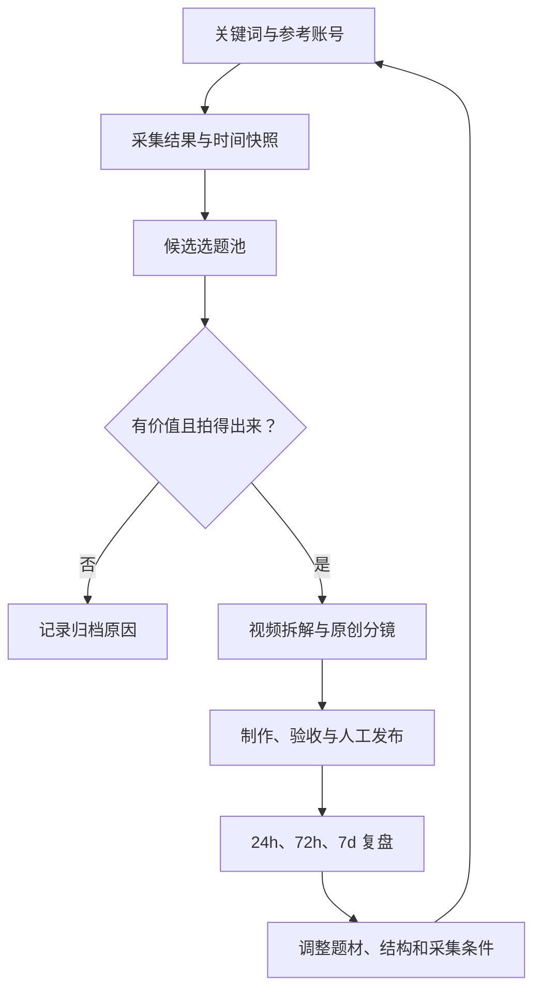

这周准备搭建一套自己的短视频工作流：从 TikTok、X 等平台寻找值得研究的内容，分析它们的表达方式，再结合自己的题材，为抖音或 B 站制作原创改编作品，最后用实际表现决定下一轮怎么做。

第一阶段的约束很明确：**零新增现金支出、一人可以维护、先做出一条作品。** 采集量先控制在每天 20 条左右；AI 分析和生成只使用当前账号确实可用的免费部分，必要时改成人工拆解和自己录屏。

**本文是待实施的搭建指南，核验日期为 2026 年 11 月 27 日。** 工具字段、公开额度和接口已对照官方资料；这里没有声称已经替我的账号完成采集、部署、生成或视频发布。代码配置需要在自己的账号做首轮验证，文中的创作演练和工时安排属于方案设计。

“零预算”指新增现金支出为零。赠送额度、已有设备和制作时间依然要记录。网页套餐、API 计费与付费会员是不同入口，不能因为某个账号有赠金，就认为所有调用都不会产生额外费用。

## 1. 本周要交付什么

截至本周日，先验收下面六件事：

- [ ] 能手动采到一批相关视频信息，原始结果可追溯。
- [ ] 同一视频能留下两次不同时间的指标快照。
- [ ] 能从候选中选出一个有原创空间、自己拍得出来的题目。
- [ ] 有一张参考拆解卡、一张原创改编卡和可执行分镜。
- [ ] 完成一条 15–30 秒左右的作品，并在选定平台人工发布。
- [ ] 保存发布版本与 24 小时观察记录，安排好后续 72 小时和 7 天复盘。

第一周不以抓到多少万条、接入多少个模型作为验收标准。每天只分析 1 条、实际制作 1 个小实验，已经足够暴露流程问题。正式跑起来后，再根据制作速度调整采集量。

**默认题材示例：AI 工具与个人工作流。** 比如一段真实录屏，展示一个具体问题、操作过程和结果。也可以替换成桌面整理、生活技巧或其他熟悉的领域，但第一周尽量只做一个方向。

## 2. 工具分工与免费边界

| 环节 | 首轮选择 | 免费规则与本周用法 |
| --- | --- | --- |
| TikTok 候选采集 | Apify + Clockworks TikTok Scraper | Apify Free 每月 $5，不需信用卡；保留 Free，用完停止。先一个关键词、20 条结果 |
| X 补充观察 | 手工收藏链接，或一次 Demo | 下文这款 X Actor 的 Free 仅每月 5 次、每次最多 10 条，不承担每天自动采集 |
| 记录与筛选 | 本地 CSV/JSON，之后用 SQLite | 先保存可读文件；自动化时由一个本地进程写库 |
| 参考视频拆解 | 人工观看；AI Studio 免费模式可选 | 只用账号当前可访问的免费模型，不把付费 API key 接入当作必需步骤 |
| 素材制作 | 自己录屏、手机实拍、自己的旁白 | 用现有设备完成主线，生成镜头是可选项 |
| 剪辑 | [剪映](https://www.jianying.com/web)当前可免费使用的基础功能 | 开始前先做 10 秒导出测试，确认素材与功能没有付费提示 |
| 复盘 | 平台创作后台 + 本地记录 | 第一周手工录入；缺少的指标保留为空 |
| 调度 | Apify Schedule，或之后的本地定时器 | 同一任务只交给一个调度器，避免重复运行 |

Apify 的免费额属于整个账户，不是每个 Actor 单独赠送 $5；已升级付费套餐的账号不能套用 Free 的“额度用完即停止”规则。参考：[Apify 定价与 FAQ](https://apify.com/pricing)。

具体 X 工具为 [apidojo/twitter-scraper-lite](https://apify.com/apidojo/twitter-scraper-lite)，限制来自它自己的 Demo 说明。其他 Actor 要分别检查，不能仅凭“每千条很便宜”就判断免费账号可以长期用。

### Bright Data 与 Firecrawl 放在哪一层

[Bright Data](https://docs.brightdata.com/general/account/billing-and-pricing/free-tier) 更偏向采集 API、浏览器及代理基础设施。当前新账号每月 5,000 credits，在符合条件的采集产品间共用；住宅等原始代理产品不包含在这个月度额度内。后续需要不同数据源或评估采集稳定性时，再拿它做对照。

[Firecrawl](https://www.firecrawl.dev/pricing) 更适合把网页转为便于处理的内容。当前 Free 为每月 1,000 credits，基础网页抓取通常按页消耗。它可以补充原帖关联的文章、产品说明和教程资料；视频文件、播放量快照和镜头分析仍需要对应环节处理。**网页数、采集记录数和可分析的视频数不能直接互换。**

### AI 免费入口怎么选

[Google 官方计费说明](https://aistudio.google.com/docs/billing#is-AI-Studio-free) 区分了 AI Studio 的免费使用与连接付费项目 API key 的使用。第一周直接选可免费使用的网页模式；遇到限额就等待恢复，或人工完成这一条分析。是否可访问还受[支持地区](https://aistudio.google.com/docs/available-regions)等条件影响。

即梦等生成工具可以在需要时查看账号已到账的免费积分、可用模型和生成前的预计消耗。本文不把固定的每日赠分数、某个付费模型或整条 AI 生成视频作为前提。免费额度不足时，用自己的实拍、录屏或静态图完成作品。

## 3. 完整流程与人工判断的位置



自动化先承担重复劳动：定时采集、保存原始数据、去重、计算观察指标、整理待办。人工负责选题、事实核对、创作取舍、素材确认、最终看片与发布。

这个安排也方便定位问题。没有抓到内容，检查采集；抓到了但不想拍，检查选题；完成了却看不懂，检查表达；发布后没有足够数据，就继续观察，不直接把原因归到平台算法。

## 4. 先建记录系统，保留每次观察

### 文件放置

可以先在电脑上建一个项目目录。下面是建议路径，不是已经创建好的服务：

```text
hot-video-workflow/config/discovery.json
hot-video-workflow/data/raw/2026-11-27/run-ID.json
hot-video-workflow/data/workflow.sqlite
hot-video-workflow/references/tiktok-VIDEO_ID/reference.mp4
hot-video-workflow/projects/2026-001/analysis.md
hot-video-workflow/projects/2026-001/brief.md
hot-video-workflow/projects/2026-001/shots.md
hot-video-workflow/projects/2026-001/media/
hot-video-workflow/projects/2026-001/exports/
hot-video-workflow/projects/2026-001/review.md
```

手动阶段，CSV 和 Markdown 就够用。切换自动化后，可以把结构化记录迁入 SQLite，原始 JSON 和媒体仍保存为文件。数据库先放在运行采集程序的机器本地目录，备份再同步到 NAS；首轮不需要多机同时写入。

### 五类记录

| 记录 | 一行代表什么 | 最小字段 |
| --- | --- | --- |
| `items` | 一个来源内容 | 平台、来源 ID、原文链接、作者、原文案、发布时间、首次发现时间、状态 |
| `snapshots` | 对来源内容的一次观察 | 来源 ID、run ID、实际采集时间、播放、赞、评、转、收藏、数据质量标记 |
| `runs` | 一次采集任务 | job key、run ID、dataset ID、输入配置、开始/结束时间、状态、实际费用、错误 |
| `works` | 自己的一件作品 | 作品 ID、参考来源、题目、内容假设、脚本/分镜路径、版本、发布链接、工时 |
| `reviews` | 作品发布后的一次复盘 | 作品 ID、发布版本、平台、实际观察时间、指标、评论摘要、结论与下一轮实验 |

需要多对多引用时，再增加 `work_sources` 关系表；第一周也可以在改编卡里列出来源链接。

**来源 ID 一律按字符串保存。** TikTok ID 这样的长数字不要交给表格自动转成科学计数法，也不要先经 JavaScript Number 再转回字符串。以 `platform + item_id` 去重；如果 X 的一条帖子含多个视频，需要进一步记录媒体 ID，或明确当前记录单位是帖子。

**快照追加，不覆盖。** 同一条视频晚些时候播放量变了，新增一行 snapshot；重复导入同一个 run 的结果，则通过 `platform + item_id + run_id` 去重。原始 JSON 留存，便于字段变化后重新解析。

字段缺失写 `null` 或“未提供”，和真实的 0 分开。采集时间统一存 UTC，界面与日报按 `Asia/Shanghai` 显示；计算时差用实际时间戳。

观察时间和导出时间分开保存，重复导出不能重置采样时间。若输出没有逐条采样时间，可以用该次 run 的结束时间作为统一近似，并标记时间精度；不要把几小时后才导出文件的时间当成数据采集时间。

### TikTok 字段映射

| 本地用途 | Clockworks 输出字段 |
| --- | --- |
| 来源 ID、原文链接 | `id`、`webVideoUrl` |
| 文案、发布时间 | `text`、`createTimeISO` 或 `createTime` |
| 播放、点赞 | `playCount`、`diggCount` |
| 评论、分享、收藏 | `commentCount`、`shareCount`、`collectCount` |
| 作者、时长 | `authorMeta.name`、`videoMeta.duration` |
| 可用媒体地址 | 实际返回的 `mediaUrls` 或 `videoMeta.downloadAddr` |
| 是否图片轮播 | `isSlideshow` |

这些字段可能为空。第一轮先排除图片轮播，把工作集中到真正的视频。映射依据：[Actor Output schema](https://apify.com/clockworks/tiktok-scraper/output-schema)。

作品状态先用一组容易理解的值：`candidate`、`selected`、`analyzed`、`scripted`、`producing`、`published`、`reviewed`、`archived`。归档时写明原因，例如题材不相关、素材难以完成、内容已经过时，而不是只删掉记录。

## 5. 第一次采集：一个关键词，20 条结果

### 控制台操作

1. 注册或登录 Apify，确认当前计划是 Free，查看本周期剩余额度。
2. 打开 [Clockworks TikTok Scraper](https://apify.com/clockworks/tiktok-scraper)。
3. 在 Input 的 JSON 编辑入口放入下面配置。关键词按自己的题材替换，第一轮只保留一个。
4. 在运行选项中设置单次费用上限，建议先用 $0.20；该上限消耗的是账户可用额度。
5. 手动启动一次。完成后查看结果、日志和 Run Cost，导出 JSON 留档。
6. 确认字段和费用符合预期后，再保存为固定 Task，例如 `tiktok-discovery-v1`。

### 可复制的发现配置

```json
{
  "searchQueries": ["AI workflow"],
  "searchSection": "/video",
  "resultsPerPage": 20,
  "videoSearchDateFilter": "PAST_24_HOURS",
  "shouldDownloadVideos": false,
  "downloadSubtitlesOptions": "NEVER_DOWNLOAD_SUBTITLES",
  "aiVideoDescription": false,
  "aiVideoSummary": false,
  "commentsPerPost": 0,
  "scrapeRelatedVideos": false
}
```

字段已按当前 [Input schema](https://apify.com/clockworks/tiktok-scraper/input-schema) 核对；没有在个人账号实际运行，所以首轮仍需检查结果。

`resultsPerPage` 按每个关键词、标签或账号计数。一个关键词设 20，和三个关键词各设 20，预算不同。首轮不要同时填关键词、账号、标签和具体视频链接。

24 小时字段是 `videoSearchDateFilter: "PAST_24_HOURS"`。结果太少时，可以手动改成 `PAST_WEEK`，同时把记录中的查询窗口改为一周。保留实际发布时间，再做本地筛选，不把一周样本称作“今天新发布”。

日期筛选、排序、下载等会触发不同计费项。当前默认排序为 `MOST_RELEVANT`；公开说明没有充分解释默认值是否一定触发排序附加费，后面的预算按会收费预留。新增功能前先看当前 Input 和 Pricing，不只看“每千条起价”。

先关闭字幕转录、评论和 AI 描述/总结。尤其当前 Input 说明 AI 视频描述与总结按成功分析的**视频秒数**计费，不能把价格页的简写直接当成“每千条视频”的费用。

### 怎么判断首轮采集通过

- 结果与题材相关，发布时间和来源链接能核对。
- 记录了实际返回数量，知道空结果也是可能结果。
- 来源 ID 没有丢失精度；缺失字段没有被补成 0。
- 至少抽查 3 条原文，核对标题、作者与指标是否合理。
- 已保存输入、run ID、dataset ID、原始 JSON 和费用明细。
- 本次消耗没有超过设定上限，没有额外启动同样任务。

失败时先读日志和输入，不反复点击 Start。HTTP 请求成功或任务创建成功，也不等于采集已经完成。

## 6. 从“高播放”走到“值得我拍”

### 先明确采到的是样本

一个关键词返回的结果受查询、地区、排序和采集时间影响。第一版日报应叫“今日候选选题”，不要叫“TikTok / X 全站今日最热视频”。

首次采到的播放量是累计数。可以把“累计播放 ÷ 发布后小时数”作为粗略历史平均值，但它不是最近一小时的实时增速。只有两次观察，才能计算两次采集之间的变化。

### 对入选 3 条做第二次快照

在第一次采集后 6–12 小时，对初选的 3 条重新启动一个只含具体链接的任务：

```json
{
  "postURLs": ["https://www.tiktok.com/@AUTHOR/video/VIDEO_ID"],
  "scrapeRelatedVideos": false,
  "shouldDownloadVideos": false,
  "downloadSubtitlesOptions": "NEVER_DOWNLOAD_SUBTITLES",
  "aiVideoDescription": false,
  "aiVideoSummary": false,
  "commentsPerPost": 0
}
```

把占位链接替换为第一次输出的真实 `webVideoUrl`，最多放 3 条。这个复抓任务不要残留 `searchQueries`、`hashtags`、`profiles`，否则可能把发现任务又跑一遍。

**重新下载旧 dataset 不会更新数字。** 必须新运行采集，再保存第二个实际观察时间和指标。配置依据仍为 [Input schema](https://apify.com/clockworks/tiktok-scraper/input-schema)。

```text
观察期间播放增速 =
  (第二次播放量 - 第一次播放量)
  / (第二次采集时间 - 第一次采集时间，按小时)
```

使用实际时间差，不固定除以 6。任一播放数缺失、时间差非正或计数下降时，标为未知/异常待查；保留原始值，不强行补零。TikTok 与 X 分别比较，不把不同口径拼成一个“全平台热度分”。

例如，以下只是计算演示：08:30 为 12,000 播放，20:30 为 30,000，观察期间平均新增 1,500 次/小时。它说明这段时间仍在增长，不证明某个镜头就是增长原因，也不保证下一条会得到同样流量。

### 人工选题卡

热度证据和“适不适合我制作”分开记录。每个候选至少写清楚：

| 判断 | 问自己什么 |
| --- | --- |
| 受众价值 | 我的观众为什么需要看？看完能获得什么？ |
| 新增内容 | 我能补充什么实测、场景、解释或不同结论？ |
| 制作可行性 | 现有设备和素材能否在本轮时间内完成？ |
| 视觉表达 | 核心证据能否直接拍出来或录屏展示？ |
| 趋势证据 | 是一个偶发高播放，还是多个作者/多次快照都给出线索？ |

可以给前四项各评 0–5 分，作为自己的粗排工具；分数只是工作约定，不是平台算法。趋势证据不足时写“待观察”，不要编造一个看起来精确的概率。

选中后写一句内容假设，例如：“对刚接触采集工具的人，先展示一张能开拍的选题卡，再解释筛选步骤，可能更容易理解这套流程有什么用。”下一条作品就围绕它做一次实验。

### 下载只服务于深入研究

最终选中 1 条后，复制复抓配置，仅保留这个 URL，把 `shouldDownloadVideos` 改为 `true`。下载任务仍会消耗基础结果额度，再叠加下载额度。

拿到地址后及时保存实际文件，检查画面和音轨。下载字段是可选项，页面 URL 不等于 MP4。官方 Input 还提醒免费计划下未命名媒体存储有保留期限，不能只依赖云端临时链接长期留档。参考：[下载配置](https://apify.com/clockworks/tiktok-scraper/input-schema) · [媒体输出](https://apify.com/clockworks/tiktok-scraper/output-schema)。

参考视频单独放在 `references` 目录。自己的成片从自制或获得许可的素材目录取材，避免研究文件和最终素材混在一起。

## 7. 免费预算：给整月留出缓冲

当前 Clockworks Free 档的基础结果价格为 $3.70/1,000；日期、搜索排序、视频下载分别每项加 $1.30/1,000；启动一次任务 $0.001。下面按这些公开事件价格估算，不代表实际账单。参考：[Actor Pricing](https://apify.com/clockworks/tiktok-scraper/pricing)。

| 每天任务 | 计算方式 | 日额度消耗 | 连续 31 天 |
| --- | --- | ---: | ---: |
| 发现 20 条，预留日期与排序 | 20 × (3.70 + 1.30 + 1.30) / 1000 + 0.001 | $0.1270 | $3.9370 |
| 对 3 条定点复抓一次 | 3 × 3.70 / 1000 + 0.001 | $0.0121 | $0.3751 |
| 下载最终选中 1 条 | 1 × (3.70 + 1.30) / 1000 + 0.001 | $0.0060 | $0.1860 |
| 合计 | 不含额外存储、导出、重试等用量 | **$0.1451** | **$4.4981** |

以每月 $5 赠额计，计划约消耗 $4.50，留下约 $0.50 缓冲。默认排序若没有收费、某天不下载或不运行，实际会更低；增加关键词、额外重跑、其他 Actor 或收费功能，则可能更高。

按同一模型，本周五到周日运行 3 天约 $0.44；连续运行 7 天约 $1.02。它们都是赠额消耗估算，新增现金支出仍可以保持 0 元。

Actor 运行页写着平台成本 Included，也不代表此后所有读取和保存都不消耗额度。[Apify FAQ](https://apify.com/pricing) 说明平台还会对存储、读写等服务计量。实际费用以任务事件明细和账户用量为准。

本轮预算规则：

1. 保留 Free，不为了这次试跑升级或充值。
2. 单次发现任务上限先设 $0.20；首轮成功后才开启每天运行。
3. 每周检查一次账户剩余赠额；低于 $0.50 就暂停新采集，继续处理已有内容。
4. “单次最多 $0.20”不是月度上限；持续重复执行仍会消耗整个账户额度。
5. 先用少量真实 Run Cost 校准估算，再决定是否扩大关键词或下载量。

## 8. 自动化怎么接：先定时，再编排 API

### 最小版本：Apify 自带 Schedule

手动采集通过后，保存固定 Task，再新建 Schedule：

| 设置 | 建议值 |
| --- | --- |
| 时区 | `Asia/Shanghai` |
| 发现任务时间 | 每天 08:30 |
| cron | `30 8 * * *` |
| 每次输入 | 已验证的一个关键词、20 条配置 |
| 每次运行选项 | 费用上限、超时与日志按首轮结果设置 |
| 复抓和下载 | 第一周晚间人工选中后再触发 |

Apify Schedule 支持时区和 cron，缺失输入可能由默认值补齐，因此保存 Task 后要再检查一次实际 Input。参考：[官方调度文档](https://docs.apify.com/actors/running/schedules)。

Apify 云端调度可以在电脑关机时启动采集；但如果导出程序运行在本地电脑，导出、入库和后续整理仍需要那台电脑运行。本文只给配置方案，没有创建任何实际日程。

不要再让 NAS cron 对同一发现任务重复提交。后面改成本地调度时，先停掉旧 Schedule，并用日期、时区、任务类型和输入版本生成唯一 `job_key`。

### 第二版：Python + SQLite 编排

服务只需要完成这些动作：

1. 在 `runs` 写入一个尚未提交的 job，检查相同 `job_key` 是否已存在。
2. 提交一次 Apify 任务，立即持久化返回的 run ID 与 dataset ID。
3. 轮询这个准确的 run ID，记录状态；不使用模糊的“最近一次运行”替代。
4. 等待 `SUCCEEDED` 后导出 JSON，保留原始结果，并在事务中写入 items 和 snapshots。
5. 生成一份本地“今日候选选题”列表，供人工选择。
6. 对选中的来源触发独立复抓/下载任务，保留来源到作品的关联。
7. 发布后先人工录入平台数据，让复盘逻辑稳定，再考虑进一步接入。

下面是接口顺序，`RUN_ID` 和 `DATASET_ID` 都要替换成该次启动响应中的值：

```text
POST https://api.apify.com/v2/actors/clockworks~tiktok-scraper/runs?maxTotalChargeUsd=0.20&timeout=300
GET  https://api.apify.com/v2/actor-runs/RUN_ID?waitForFinish=30
GET  https://api.apify.com/v2/datasets/DATASET_ID/items?format=json&clean=1
```

认证使用 `Authorization: Bearer <APIFY_TOKEN>`，JSON body 为已验证的 Input。token 只保存在本地环境变量或受保护配置中，不写进公开仓库、博客和截图。

`maxTotalChargeUsd` 是启动接口的 URL query 参数，放在 Actor Input JSON 里不能替代运行费用控制。POST 成功只说明任务已启动；`FAILED`、`TIMED-OUT`、`ABORTED` 都要记录，不当作正常结果继续写日报。

API 文档：[启动 Actor](https://docs.apify.com/api/v2/actors-runs-post) · [读取运行状态](https://docs.apify.com/api/v2/actor-run-get) · [读取 Dataset](https://docs.apify.com/api/v2/dataset-items-get)。

首次写编排时，把不确定请求当成一个明确状态处理：POST 超时但不知道是否创建成功，先查询运行记录或人工核对，再决定是否重试。不要直接无限重发。GET 可以限次重试并退避；遇到输入错误先修配置。

任务完成后的费用统计可能有短暂延迟，隔一会儿再核对。准确 run ID、原始输入、日志、费用事件和数据质量标记，比一个只显示“成功”的仪表盘更有助于排错。

## 9. 把参考视频变成可执行的观察记录

每次只深入分析 1 条，并保留原始链接、作者、采集时间和本地参考文件。先看完整视频，再拆出时间段，避免先给“高级感”“有网感”等模糊标签。

分析至少分成三层：

| 层次 | 要回答的问题 | 可交付内容 |
|---|---|---|
| 可观察事实 | 在哪个时间点出现了什么画面、声音和文字？ | 时间码、画面动作、字幕、声音、可读性 |
| 创作判断 | 这个安排可能怎样影响理解或注意力？ | 解释与证据、不确定性 |
| 本人可用的方法 | 哪个结构能服务自己的题材？现有条件能否完成？ | 原创题材、证明素材、替代镜头、制作成本 |

例如，“00:00–00:02 先显示整理后的桌面，00:03 才出现整理过程”是观察；“这可能让观众先确认视频能给出什么结果”是解释；“它一定因为这个开头而爆火”则没有充分证据。公开播放与互动数字无法单独证明一个创作因素的因果作用。

### 给视频分析模型的输入

优先提供实际视频文件与文字说明。Google 的视频理解文档分别说明了文件输入和公开 YouTube 视频 URL；不能据此推定任意 TikTok/X 网页 URL 都会被当成视频完整读取。只得到页面标题、文案或采样截图时，分析记录必须明确输入范围。[Google 官方视频理解文档](https://aistudio.google.com/docs/video-understanding)

默认静态视频处理约以每秒 1 帧抽取画面。快速切镜、闪现字幕、精确切点和口型应在剪辑软件中人工复核；增加模型解释文字不会自动补回未采到的画面。这里不要求第一周写 API，先用可访问且免费可用的网页模式上传短视频即可。该采样说明来自 API 文档，具体网页入口的处理策略以界面和产品说明为准。[静态处理与采样](https://aistudio.google.com/docs/video-understanding#agentic-video-understanding)

### 可复制提示词：参考视频拆解

```text
任务：把附件视频拆成一份可执行的视听分析，不生成改写脚本。

先说明你实际读到了什么：完整视频及音频、采样帧、图片，还是仅页面文字。
没有读到实际视频时停止逐镜判断，告诉我缺少的输入；不要根据标题猜画面。

请输出：
1. 一句话说明它给哪类观众提供什么价值。
2. 时间段表：起止时间、可见动作、景别/构图、镜头或画面的运动、
   屏幕文字、旁白/声音、该段结束时观众新增的信息。
3. 开头、信息展开、关键证据、转折与结尾各自做了什么。
4. 能复用的表达方法：例如结果前置、操作对照、逐步揭示、声音衔接。
5. 需要人工复核的时间点，尤其快速切镜、闪现文字、听不清的语音。
6. 三个适合小团队复用的制作方法，以及资源不足时的替代。

把输出分为“观察到”“解释假设”“尚不确定”。
不要推断原作者的真实设备、精确灯位、收入或流量来源。
不要声称已经证明它走红的原因。
不抄录整段原台词，不把原视频画面直接当作我的成片素材。
```

检查模型输出时，至少回看它提到的开头、关键证据和结尾三个位置；发现时间码错误就直接修正记录。不要让错误的分镜表继续流入制作阶段。

## 10. 从参考结构写出原创改编卡

一张改编卡只回答五个问题：

| 字段 | 本轮要写清楚的内容 |
|---|---|
| 参考方法 | 借鉴什么表达方法，例如“先展示结果，再解释操作” |
| 本人题材 | 为哪类中文观众解决什么具体问题 |
| 新增价值 | 自己实测、不同场景、更清楚的解释或相反结论是什么 |
| 可证明素材 | 哪段录屏、实拍、对照或数据能够支持说法 |
| 制作边界 | 时长、现有设备、时间上限、可用素材与免费额度 |

换语言、换音乐、替换几个名词，并不能替代自己的题材、证据与表达。本文里的“复刻改编”以学习结构、镜头语言和表达方法为目标；成片使用自己拍摄、录制或已获准使用的材料。涉及他人的画面、音乐、声音或肖像时，把授权来源和适用范围一起记进素材表；跨平台发布前分别检查音乐可用范围，不默认一个平台内可用的音乐也能带到另一个平台。

### 可复制提示词：生成改编方案

```text
下面是参考视频的分析结果，以及我的制作条件。
请把可借鉴的表达方法转成原创方案，不逐句翻译原台词，不复用原视频画面。

我的观众：[例如：刚开始用 AI 做小工具的独立开发者]
我的题材：[一个明确问题]
我实际验证过的事实：[列出证据，没验证的标记待验证]
我的现有素材：[自己的录屏、手机实拍、图片等]
制作条件：[一人、电脑录屏+手机、零新增支出、预计制作时间]
成片目标：[例如：竖屏 30 秒，讲清一个方法]

先给 3 个不同切入点，每个写明：
观众得到的具体价值、开头呈现的证据、主要风险、我需要补拍什么。
推荐其中 1 个，并说明为什么适合我的资源。

再输出推荐方案：
1. 一句话内容承诺，避免未实测的夸大结论。
2. 原创旁白。
3. 逐镜表：镜号、时间段、叙事任务、实际画面、运动、字幕、声音、
   所需素材、通过标准、低成本替代。
4. 与参考内容的关系：保留的方法、重新设计的部分、我新增的证据。
5. 还需要我亲自验证的事实。

镜头时间相加必须等于目标成片时长。
台词安排只是草案；提醒我实际朗读计时，不用固定字数速度冒充实测。
不要把付费生成视频作为完成方案的前提。
```

## 11. 完整演练：把 20 条候选整理为一张选题卡

**这是虚构练习，不是真实热点，也不是已经完成的效果案例。** 先用 20 行演示数据和自己制作的卡片练习拍摄。画面中标注“演示数据”，实测跑通后再使用真实结果和准确说法。

选题：用一个自己的实际工作场景，演示“候选资料 → 判断条件 → 可以开拍的选题卡”。

借鉴方法：先给观众看最终产物，再补充筛选理由和操作证据。

原创价值：展示自己怎样从资料中选一个能完成的作品，并记录不确定性；不承诺工具能自动判断真正的全站热点。

制作条件：一台能录屏的电脑、一部手机、自己的旁白。最终入剪 30 秒，竖屏 9:16；画幅和片长是本例选择，不是平台硬性规格。准备横屏录屏原件时让关键内容位于中间，必要时另录竖屏友好的窄窗口，避免把整张桌面硬裁成无法阅读的小字。

### 30 秒镜头表

| 镜号 | 时间 | 叙事任务与画面 | 声音/字幕 | 执行与验收 |
|---|---|---|---|---|
| S01 | 0–3 秒 | 先展示最终选题卡，卡上只有题目、证据、下一步三行；画面角落标注演示数据 | 旁白：“我想把候选资料，变成今天能拍的一条。” | 固定画面，观众能读清主标题；避免整个表格缩在屏幕中央 |
| S02 | 3–7 秒 | 自己制作的 20 行候选表；选中题材与发布时间两列，删去明显不相关的行 | “先看题材和时间，留下相关的。” | 录制真实操作；每次只强调一列，不用花哨转场掩盖筛选 |
| S03 | 7–13 秒 | 两张自己制作的候选摘要卡对照，分别标出“需要外拍”和“现有素材可演示” | “再看能不能验证，手里有没有素材。” | 两项差异真实可辨；本例不播放他人视频，也不伪造播放数字 |
| S04 | 13–18 秒 | 在实际可用的 AI 工具中输入自己的筛选条件，然后切到整理好的草稿卡 | “把条件写清楚，让 AI 帮我整理草稿。” | 如省略等待过程，画面标注“等待已剪辑”；输出必须经过人工检查 |
| S05 | 18–25 秒 | 放大选题卡中的三行：开头展示什么、需要哪段证据、下一步拍什么；勾选已确认项 | “开头、证据、镜头，逐项确认再开拍。” | 精确文字在剪辑软件排版，或录制真实 UI；不用生成模型绘制易错文字 |
| S06 | 25–30 秒 | 画面固定在最终卡片，补上“下一次只测试一个开头”的小字 | “下一条，再验证哪种开头更容易看懂。” | 结尾保留阅读时间，声音自然结束；不添加未经证实的效率倍数 |

镜头总长为 3 + 4 + 6 + 5 + 7 + 5 = 30 秒。旁白需要自己录一遍计时；太长先删重复解释，或将目标片长调整为 35 秒并重新分配镜头。不能为了凑 30 秒把录音机械加速到难以听清。

### 拍摄顺序与剪辑顺序分开

先准备选题卡和演示表格，确认 S01/S05/S06 的文字真实且一致；再一次录完 S02/S03/S04 的操作画面；随后录旁白，最后补一条手机桌面或手部镜头作为可选转场。先完成这六个必需镜头，再决定是否补装饰画面。

把原始录屏、原始录音、卡片源文件、剪辑工程和最终导出分开保存。文件名包含项目 ID 与镜号，例如“项目 001 的 S04 操作录屏”。同一镜头有多个版本时保留版本号，避免修改后不知道哪段支撑了哪句结论。

### 无付费依赖的制作顺序

1. 先剪一条“没有音乐也能看懂”的工作版，检查信息顺序和证据。
2. 再加自己的旁白，字幕只保留关键内容，重要操作区留出空间。
3. 最后调节声音、必要的局部放大和简单转场。手机外放也应能听清。
4. 在剪辑工具中先导出一个 10 秒小项目，确认所选素材和功能没有付费提示，再制作整条。
5. 回看导出的实际文件，检查字幕边缘、画面清晰度、声音断点和黑场；上传草稿后再看平台 UI 是否遮住关键文字。

实拍可以靠窗安排稳定光线，固定手机机位，录音先试读和回放。复杂运镜不是本例的必要条件；录屏里的光标移动和局部放大也应服务于观众注意的位置。

### AI 生成镜头是可选补充

如果需要一段抽象的桌面或场景镜头，先固定构图与关键物件，再试一个主要动作。免费积分用尽就换成自己的实拍或静态图，不中断整条作品。

通用镜头卡示例：

```text
镜号：B01，可选，最终入剪 2 秒
任务：从表格切到整理完成的状态
参考资产：本人拍摄的桌面照片
起始状态：桌上摊开三张无文字的便签
动作：一只手把三张便签叠整齐，完成后停住
相机：固定近景
结束状态：便签叠放整齐，手离开画面
连续性：手、衣袖、桌面、光源方向与参考图一致
验收：动作完整、手与纸张接触自然、无额外物体突然出现
替代：手机实拍相同动作，或直接硬切到整理后的桌面
```

生成请求时长、实际可用段落和最终入剪时长分开记录。不要按“生成了 5 秒”就认定能用 5 秒；优先确认动作完整与接片，再决定入点和出点。精确 UI、数字、结果截图和文字使用真实录屏或后期排版。

## 12. 为抖音与 B 站分别设计一个版本

这里把两版当作两种内容表达实验；不宣称平台一定偏好某种固定时长或画幅。

| 项目 | 抖音首轮建议 | B 站首轮建议 |
|---|---|---|
| 本轮目标 | 让首次看到的人迅速理解一个结果或方法 | 让有兴趣的人学会复现，并理解适用范围 |
| 试验版本 | 20–45 秒竖屏，只讲一个动作链 | 2–4 分钟演示版；需要时选择横屏展示完整 UI |
| 开头 | 展示真实结果或具体问题 | 先展示结果，再明确条件、成本与会讲到的内容 |
| 中段 | 保留关键证据与一个必要解释 | 加入实际操作、失败情况和替代方案 |
| 结尾 | 留下明确结论与一个与主题相关的问题 | 给复现步骤、参考来源和下一轮测试点 |
| 素材 | 从原始素材中剪出适合竖屏的构图 | 使用原始录屏补完整解释，保留阅读时间 |

第一周先完成一个能发布的版本，再决定是否做第二版。将同一条竖屏视频直接同步到 B 站也可以作为初始实验；若要做“教程版”，需要增加信息，而不只是把画布改为横屏。标题和封面必须与实际内容一致；“实测”“免费”“自动”等词只有在该版本中确实验证后才使用。

## 13. 发布后记录：24 小时、72 小时与 7 天

发布前保存一个不可覆盖的版本记录：作品 ID、平台、发布时间与时区、成片时长、标题/封面、开头版本、目标受众、内容承诺、素材来源、总工时和实际现金支出。若后来改过封面、标题或内容，新增版本记录。

以下时间点是为了让自己持续观察，属于项目约定，不是平台效果保证：

| 时间点 | 重点问题 | 要留下的判断 |
|---|---|---|
| 发布后 24 小时 | 内容能否正常播放，封面与开头是否兑现内容，评论有没有明显误解？ | 排查呈现问题，记录首轮数据，不急于宣布成功或失败 |
| 发布后 72 小时 | 观众在哪里离开，什么问题被反复提到，内容有没有被收藏/分享？ | 找一个最值得改变的变量，形成下一条假设 |
| 发布后 7 天 | 同一类题材是否值得继续，制作成本是否可持续？ | 继续、改变方向或归档，并说明依据 |

### 最小复盘字段

- 播放量、点赞、评论、收藏、分享；平台没有的字段写“未提供”，不补 0。
- 后台实际提供的平均观看时长、完播率、留存曲线；记录字段名称和统计口径。
- 可归因的新增关注；没有可靠归因就记录账号同期变化并标注“不能归因于单条”。
- 代表性评论或问题摘要，区分具体需求、误解和普通情绪回应。
- 采集/筛选、脚本、素材、剪辑、发布各阶段工时；免费额度消耗与现金支出分开。
- 这条的一个制作目标是否达成，例如“观众能说清三个步骤”。
- 下一条只改变什么，什么结果会支持或削弱这个假设。

可以补充两个简单的观察指标，但始终保留原始计数：

```text
互动率 =（点赞 + 评论 + 分享）÷ 播放量
收藏率 = 收藏 ÷ 播放量
```

播放量为 0 时比率记为空。不要把平均观看时长除以视频时长当作官方完播率；也不要把不同平台的同名数字当作完全相同口径。只在相同平台、相近内容类型与相近发布后时长下做初步比较，至少同时查看分母。

一条低播放视频的高互动率可能来自很小样本。一周只有少量作品时，结论是“下一轮值得试什么”，不适合宣称已经发现稳定的爆款公式。

### 可复制提示词：复盘与下一次实验

```text
你是我的视频制作复盘助手。下面是作品信息、发布后多个时间点的数据、
平台后台字段说明、制作工时和代表性评论。

请先核对：是否缺字段、统计时间是否一致、是否混用了不同平台口径。
缺失值保持未知，不填 0，不编造平台后台不可见的原因。

输出：
1. 观察事实：引用具体数据或评论。
2. 解释假设：可能原因、替代解释与证据不足之处。
3. 一个优先修改项：说明修改什么、预期改善哪个观察指标。
4. 下一条的实验卡：保持什么不变、只改什么、观察窗口、
   什么结果支持假设、什么结果不足以判断。
5. 制作成本：哪一步最耗时，如何用更简单的方法保留表达效果。

不要仅根据播放量判断内容质量，不归因于“限流”或算法偏好，除非有明确证据。
不要一次同时改题材、时长、开头、封面和发布时段。
```

假设案例：后台显示较多人在操作说明开始后离开，且评论反复问“第一步在哪”。下一条可以保留同类题材与相近片长，将第一步的实际点击放大，并删掉重复铺垫，观察相近发布后时长的对应留存变化和相关提问。若样本很少，记录为“尚不能判断”；不能把两条非随机发布的视频直接当作严谨的 A/B 因果实验。

## 14. 每条作品结束后必须留下的四件东西

1. 一张参考拆解卡：观察证据、解释假设、可借鉴方法。
2. 一张原创改编与镜头卡：自己的题材、自己的证据、可以执行的镜头。
3. 一份实际成片与版本记录：原始素材、工程、输出、发布链接。
4. 一张复盘与下一次实验卡：事实、假设、改动和验证窗口。

这样第二条作品可以复用可行的方法，同时用新证据修正判断。采集量增加之前，先确认这四件产物都能稳定完成。

## 15. 本周五到周日的搭建安排

现在是 2026 年 11 月 27 日，周五。把本周目标压到三天，并让发布后的观察延续到下周。

| 日期 | 主要工作 | 当天通过标准 |
| --- | --- | --- |
| 周五 11/27 | 选定题材；建目录和记录表；手动采 20 条；校验字段与费用；初选 3 条 | 原始 JSON、来源链接、输入与 Run Cost 都可追溯；当天晚些时候能复抓第二个快照 |
| 周六 11/28 | 深入拆解 1 条；完成原创改编卡与分镜；录屏/实拍；剪辑、验收并发布第一条 | 有自己的证据与素材；导出文件可正常观看；保存发布链接、标题/封面、版本和工时 |
| 周日 11/29 | 根据首轮费用打开每日发现任务；检查任务去重和记录；完成首条作品的 24h 观察；选出下一题 | 定时任务只启动一次；新快照没有覆盖旧数据；得到一个清楚的下一轮修改假设 |

时间可以按实际安排调整。周六发布的视频，72 小时观察落在 **12 月 1 日周二**，7 天观察落在 **12 月 5 日周六**；以真实发布时间计算，不把这两项写成周日就能完成。

第一周如果编排 API 花了太久，保留“Apify 定时 + 手动导出/分析/复盘”也可以完成内容流程。优先把第一条作品和记录做完整，再把最频繁的重复步骤写成程序。

## 16. 常见问题与处理顺序

| 现象 | 先检查什么 | 下一步 |
| --- | --- | --- |
| 20 条只返回几条 | 关键词、时间窗口、日志和实际平台结果 | 接受实际数量；需要放宽到一周时记录窗口变化 |
| 费用高于预计 | 关键词数量、日期/排序、评论、转录、AI 开关、重复运行 | 停掉日程，按事件明细找差异，再恢复单次小测试 |
| 每天有重复视频 | 是否按平台与来源 ID 去重 | items 保持一条，新的有效观察进入 snapshots |
| 播放量一直不变 | 是否只是在重新读取同一个 dataset | 对实际 URL 新建复抓任务，保存新 run ID |
| 复抓计数下降 | 是否同一内容、字段为空或平台修正 | 标记异常并保留原值，不直接用负增速判断题材 |
| 找不到可用视频文件 | 是否开启了下载、是否返回媒体字段、链接是否仍可用 | 在原页面人工核对，必要时跳过；不要把网页地址当媒体 |
| 模型描述了不存在的镜头 | 输入是否只有网页文字、采样帧不足或时间码错误 | 提供实际文件，人工复看关键位置并修正 |
| 免费模型无法使用 | 当前入口、地区条件、模型、限额、是否选到了付费项目 | 人工拆解或等待额度恢复，制作仍可继续 |
| 剪辑到导出才收费 | 时间线中的会员素材、特效和高级处理 | 先替换收费项；下一条开工前先做 10 秒导出验证 |
| 采集成功但本地没有结果 | 运行 ID、导出步骤、本地进程是否运行 | 从准确 dataset 恢复导入，不重新启动整次采集 |
| 有很多收藏却一直不制作 | 候选是否超出设备、素材和时间能力 | 降低题材复杂度，只保留一个当天能做的方案 |
| 作品播放少，无法判断原因 | 样本量、观察时长、开头呈现、后台是否有足够数据 | 记录未知，只选一个变量继续试，不编造“限流”结论 |

出现技术故障时保存输入、日志和错误状态，让下一次能够接着处理。出现创作卡点时缩小表达目标，让一条作品只讲清一个问题。

## 17. 交给 Codex 实施时的任务说明

下面是一份可以继续使用的开发任务书。它描述的是**接下来要实现的程序**，本文没有附带或宣称已有可运行服务。第一次只实现采集和记录，视频分析、发布与复盘保留人工入口。

```text
请按这篇指南，在一个独立目录实现个人热点选题工作流的最小版本。

目标与约束：
- Python 3 + SQLite + 本地文件，不先做复杂前端。
- 首轮仅一个 TikTok 关键词、20 条发现结果；X 先允许手工录入链接。
- 使用 Clockworks TikTok Scraper 当前公开 Input schema。
- 配置文件、原始 JSON、媒体、分析卡、作品、复盘分开保存。
- 真实请求默认关闭；先用本地样例验证解析、去重与费用估算。
- API token 仅从环境变量读取，不写日志、不提交仓库。
- 不自动启用模型付费、不充值、不自动发布视频。

数据与编排：
1. 建 items、snapshots、runs、works、reviews，必要时加 work_sources。
2. 来源 ID 为字符串；缺失计数为 null；保留原始来源和实际采集时间。
3. 为每个发现任务生成唯一 job_key，并用本地锁避免并发重复提交。
4. POST 成功后立即保存 run ID；响应不确定时进入待核对状态，不盲目重试。
5. 针对该 run 轮询；成功后分页导入 dataset，重复导入不生成重复快照。
6. 支持手工选中 3 条后定点复抓，只下载最终选择的 1 条。
7. 记录输入版本、实际费用、失败原因；提供本周期额度消耗汇总。
8. 首轮设置单次费用上限；在配置的月度保守阈值附近停止新任务。
9. 如果无法可靠读取剩余额度，暂停自动执行并提示人工确认，不假装知道余额。
10. 生成本地候选日报，包含来源链接、原始计数、观察增速、缺失项与待办。

验证重点：
- 长数字 ID 不丢精度。
- 同一 run 重复导入不重复记账、不重复插入快照。
- 同一内容第二次采集追加快照，不覆盖历史。
- 计数缺失、下降、时间差异常时不输出虚假增长率。
- POST 超时、429、任务失败和费用接近阈值有明确状态。
- 费用估算将关键词数量、筛选和下载开关算进去。

实施顺序：
先给出最小目录、配置与样例数据，验证上述关键行为；
再提供真实单次试跑入口与操作说明；
一次真实任务验收后，最后接入唯一的调度器。
```

这个任务书的价值在于把“能定时抓数据”变成“出了问题也知道发生了什么”。后续要加模型 API、网页看板或消息通知时，沿用同一组来源、作品与版本 ID，不另起一套无法关联的记录。

## 18. 搭完以后，什么值得继续投入

两三条作品之后，再根据实际瓶颈决定下一步：

- **找不到值得做的题目**：先调整关键词、参考账号和受众定位。
- **题目很多但做不完**：减少采集量，增加制作可行性筛选。
- **每次都在手工整理同样信息**：优先自动化导出、字段映射和卡片生成。
- **生成镜头经常失败**：减少依赖，保留实拍与录屏的替代方案。
- **已有持续产出且明确耗尽免费额度**：再比较付费采集或模型服务的实际收益。

每一轮应当能沿着来源链接找到分析记录、沿着分析找到原创改编理由、沿着发布版本找到对应复盘。后续积累下来的不仅是候选视频，也包括自己验证过的题材、表达方式和制作方法。

本文的套餐与接口信息以 2026 年 11 月 27 日公开页面为核对基准；实际开跑前再看一次账号计划、当前 Input、Pricing 与 Run Cost。工具事实已在相应章节链接官方来源，镜头设计、评分方法、工作量和时间表均为本项目的实施建议。
